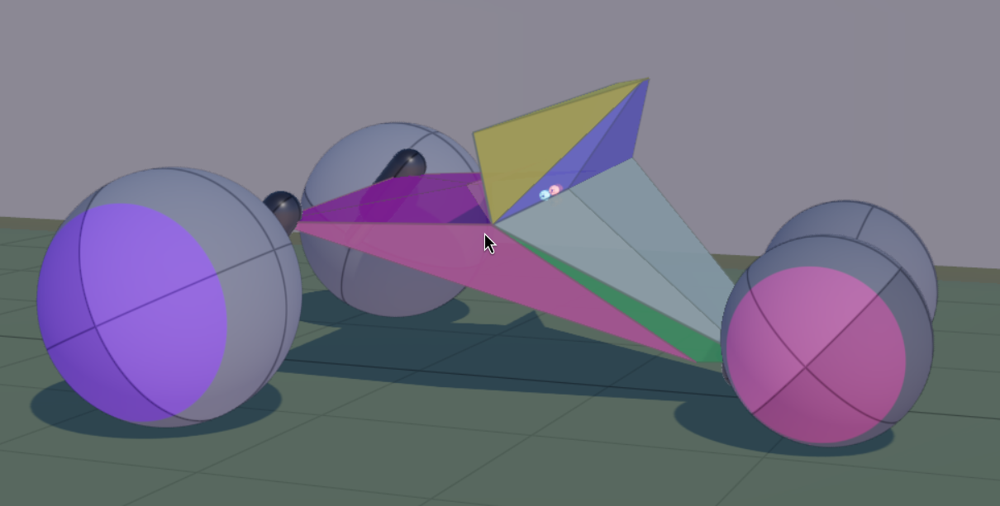

# Boxcar3D

Simulated evolution of cars built on Box3D physics.


Live at [boxcar3d.com](https://boxcar3d.com)

Each car is derived from a genome which defines:

- A prism chassis of 8 segments (an angle and a radius for each)
- A set of wheels (how many, and each wheel's angle, size, and weight)
- A palette of colors for the parts

At the end of each generation the cars in that cohort are used to create the next with the probability of contributing to the crossover proportional to score. In addition there is a probability of mutation for each part of the car.

Inspired by [boxcar2d.com](http://boxcar2d.com) (still runnable! [archive.org/details/boxcar2d.v3.2](https://archive.org/details/boxcar2d.v3.2)) and the release of [Box3D](https://github.com/erincatto/box3d), upon which Boxcar3D is implemented.

## Building and running

Boxcar3D is written in [Odin](https://odincoding.com/) on top of a bespoke engine.

```sh
just run boxcar3d       # native linux
just wasm boxcar3d      # browser build
```

System requirements live in the root `justfile` header: `odin`, `gcc`,
`cmake`/`make` + X11/GL headers for native; `clang` (wasm32 target) for wasm;
`sokol-shdc` on PATH for a fresh checkout.

## Changelog

**0.1.2** - 2026-10-22

- The browser build no longer depends on Emscripten: it compiles with plain clang and the Odin driver, removing the dependency on emsdk.

**0.1.1** - 2026-10-19

- Increase substep to fix a blow-up that exploded some cars.
- Fixed the mass accounting that caused strut barrels to count twice.

**0.1.0** - 2026-10-18

- Initial release.
